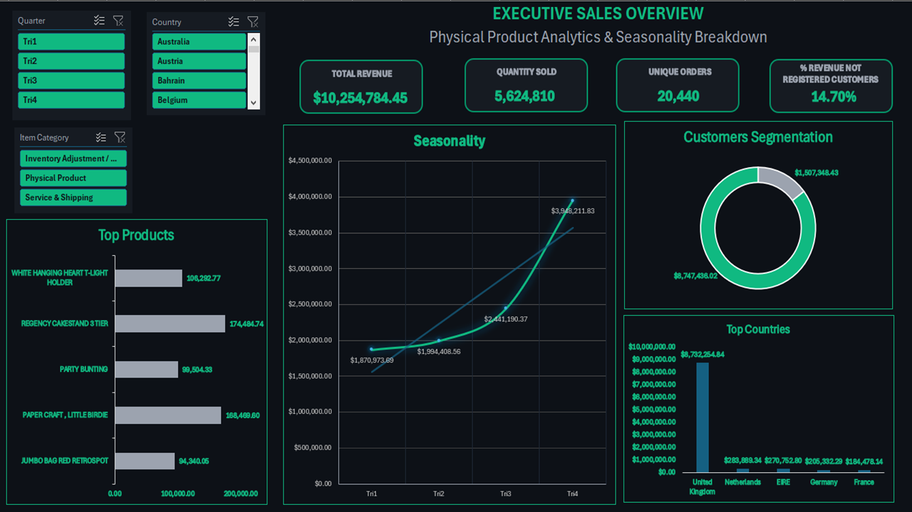

# 🛒 E-commerce Analytics & Customer Conversion Strategy

Análisis exploratorio avanzado de **541,909 registros transaccionales** en el comercio minorista, con un enfoque estratégico en segmentación de clientes, control de calidad de datos, estacionalidad comercial y conversión de compradores invitados (*Guest*) a miembros registrados (*Member*).

---

## 📌 1. Contexto del Proyecto

La compañía analizada procesa un volumen de negocio robusto que asciende a **$10,254,784.45 USD** en ingresos por productos físicos (equivalente a 5,624,810 unidades y 20,440 órdenes únicas). Sin embargo, un hallazgo crítico detectado en el modelo de negocio revela que **el 14.70% de las ventas ($1,507,348.43 USD)** proviene de clientes invitados (*Guest*) que no cuentan con un ID de registro en el sistema.

Este proyecto aborda todo el ciclo analítico: desde la limpieza de datos y eliminación de ruido operativo en Python, hasta el modelado de inteligencia de negocios en Excel y el diseño de un plan táctico para capturar ese valor inexplorado.

### 🛠️ Herramientas Utilizadas
* **Python (`pandas`, `numpy`):** Pipeline ETL, estandarización de cadenas, tratamiento de nulos, ingeniería de variables de ingresos y clasificación avanzada de ruido e ítems transaccionales.
* **Microsoft Excel (Power Query / Tablas Dinámicas):** Modelado relacional, cálculo de métricas financieras, segmentación estacional y diseño de un Dashboard Ejecutivo con estética profesional.

---

## ❓ 2. Preguntas Clave que quise resolver

1. **Impacto de Clientes Guest:** ¿Qué porcentaje de los ingresos totales representan los compradores no registrados y cuál es el tamaño de esta oportunidad financiera?
2. **Estacionalidad y Picos de Demanda:** ¿Cómo se comportan las ventas trimestrales y en qué momento del año se concentra el mayor volumen de compras de invitados?
3. **Concentración Geográfica:** ¿Cuáles son los mercados internacionales clave que sostienen la facturación global de la empresa?
4. **Higiene de Datos y Ruido Operativo:** ¿Cómo afecta la presencia de ajustes de inventario, mermas y cargos de envío a la precisión del análisis comercial?

---

## 📂 3. Estructura del Repositorio

* **`Data/ecommerce_sample_github.csv`** — Muestra estratificada (1,073 registros) del dataset procesado (`cleaned_Ecommerce_v2.csv`, 541,909 registros totales).
* **`Notebooks/Data_cleaning_ecommerce.ipynb`** — Script de Python con el pipeline ETL completo y auditoría de datos.
* **`Reports/Executive Report.pdf`** — Reporte ejecutivo completo listo para descargar.
* **`Outputs/executive_dashboard.png`** — Captura visual del tablero en Excel.
* **`Readme.md`** — Documentación principal del proyecto.

---

## 🔍 4. Principales Hallazgos y Análisis

### 👥 Segmentación de Clientes: El Desafío "Guest" vs "Member"
Al segmentar el total de **$10.25M USD** en ingresos por productos físicos:
* **Members (Registrados):** `85.30%` del ingreso total ($8,747,436.02 USD). Son la base sólida y recurrente del negocio.
* **Guests (Invitados):** `14.70%` del ingreso total ($1,507,348.43 USD). Representan más de $1.5M USD en transacciones anónimas donde la empresa pierde capacidad de retención, marketing personalizado y análisis de ciclo de vida del cliente (LTV).

### 📈 Estacionalidad Comercial
El análisis trimestral demuestra una aceleración drástica hacia el cierre de año, impulsada por compradores ocasionales:
* **Tri1:** $1.87M USD
* **Tri2:** $1.99M USD
* **Tri3:** $2.44M USD
* **Tri4:** $3.95M USD *(Pico máximo de la operación y estacionalidad de invitados)*.

### 🌍 Distribución Geográfica
* El **Reino Unido** lidera de manera absoluta con **$8.73M USD**, seguido por mercados europeos clave como **Países Bajos** ($283.8k USD), **EIRE** ($270.7k USD), **Alemania** ($205.3k USD) y **Francia** ($184.4k USD).

---

## 📊 5. Vista Previa del Dashboard


---

## 💡 6. Propuestas Estratégicas para la Conversión de Guest a Member

1. **Incentivo de Registro en el Checkout (Impacto Alto / Esfuerzo Bajo):** 
   * Ofrecer un beneficio inmediato (ej. envío gratis en la primera compra o 10% de descuento acumulable) a cambio de completar el registro de cuenta antes de finalizar el pago.
2. **Post-Purchase Conversion Campaign (Impacto Alto / Esfuerzo Medio):** 
   * Automatizar correos transaccionales post-compra dirigidos a clientes *Guest*, destacando el seguimiento de su pedido en tiempo real mediante la creación de una cuenta en la plataforma.
3. **Programa de Lealtad por Tiers (Impacto Medio / Esfuerzo Alto):** 
   * Diseñar beneficios exclusivos para miembros registrados (acceso anticipado a inventario de alta rotación y acumulación de puntos), reduciendo gradualmente la fricción de registrarse.

---

## 🚀 7. Cómo clonar y revisar el proyecto

```bash
git clone https://github.com/pedro-vargas-data/Analytics-ecommerce.git
cd analytics-ecommerce
```
##Desarrollado por Pedro Vargas Salgado | www.linkedin.com/in/pedrovargas-data-mba
